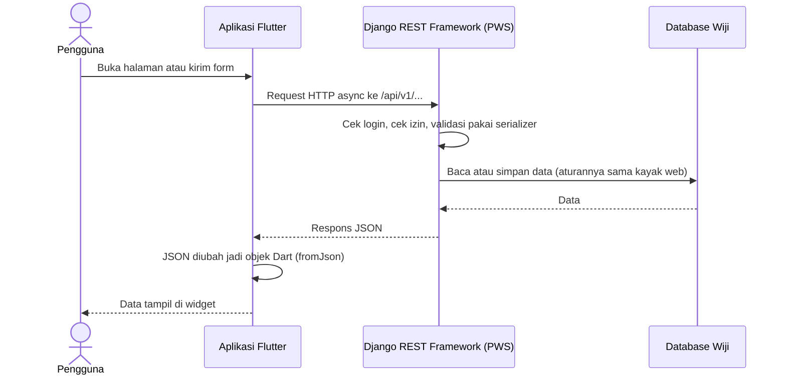

# Wiji Mobile

> Versi mobile dari **Wiji**: cek kondisi tanah dan dapet rekomendasi tanaman buat merawat atau memulihkan lahan, langsung dari HP.

**Kelompok:** D12 · **Kelas:** PBP-D · **Tema:** Sustainable Living · **Subtema:** Sustainable Soil and Land Management

**Desain Figma:** _menyusul_ · **APK:** _menyusul setelah Checkpoint 1_

## Tentang Aplikasi

**Wiji Mobile** bantu petani dan pemilik lahan ngurus lahannya dari HP. Pengguna bisa nyatet lahan, mesen pemeriksaan tanah, liat hasilnya, terus dapet rekomendasi tanaman yang cocok sama kondisi tanah, cuaca, dan iklim lahannya. Tanaman yang dipilih bisa disimpen jadi rencana tanam.

Aplikasi ini **nggak punya database sendiri**. Semua data tetap disimpan di proyek web Wiji (Django), terus diambil dan dikirim lewat API Django REST Framework. Jadi apa pun yang diubah di HP langsung keliatan di web, dan sebaliknya.

Nama **Wiji** dari bahasa Jawa, artinya benih.

## Anggota Kelompok

| Nama | NPM | Modul |
|---|---|---|
| Rania Fauziah Nur Wahyudi | 2506595070 | A. Manajemen Lahan |
| Muhammad Osman Fardin | 2506541723 | B. Pemesanan Pemeriksaan |
| Nadya Sekar Kayrana | 2506607133 | C. Hasil Pemeriksaan Tanah |
| Yosua Peitho Purba | 2506657402 | D. Katalog Tanaman |
| Piedra Ridwan Azra Pulungan | 2506623055 | E. Rekomendasi dan Rencana Pengelolaan |

## Peran Pengguna

| Peran | Yang bisa dilakukan di aplikasi |
|---|---|
| **Pengunjung** | Liat katalog tanaman tanpa login, daftar akun, dan masuk. |
| **Pemilik Lahan** | Ngatur lahan, mesen pemeriksaan, liat dan nambah hasil pemeriksaan, dapet rekomendasi tanaman, dan bikin rencana tanam. |
| **Petugas Pemeriksa** | Liat tugas pemeriksaan, update status pemeriksaan, isi hasil, dan finalin hasil. |
| **Admin** | Kelola katalog tanaman. Urusan admin lain (nugasin petugas, jadwal final, bikin akun petugas) tetap lewat web. |

## Modul dan Pembagian Kerja

Tiap modul terdiri dari **endpoint DRF** di repo web dan **halaman Flutter** di repo ini. Rincian halaman, endpoint, dan target tiap modul ada di [docs/WORK-PLAN.md](docs/WORK-PLAN.md).

### Modul A: Manajemen Lahan
**Penanggung jawab:** Rania Fauziah Nur Wahyudi

Daftar lahan (aktif dan arsip), tambah dan ubah lahan lengkap dengan pencarian alamat, detail lahan, serta arsip, pulihkan, dan hapus.

### Modul B: Pemesanan Pemeriksaan
**Penanggung jawab:** Muhammad Osman Fardin

Pemilik mesen pemeriksaan, liat status dan riwayatnya, batal, atau minta jadwal ulang. Petugas liat tugasnya dan majuin status dari dijadwalkan sampai diproses.

### Modul C: Hasil Pemeriksaan Tanah
**Penanggung jawab:** Nadya Sekar Kayrana

Daftar dan detail hasil (pH, kelembapan, tekstur, unsur hara, kontaminan). Pemilik bisa masukin hasil mandiri, petugas ngisi dan finalin hasil buat pesanan yang lagi diproses.

### Modul D: Katalog Tanaman
**Penanggung jawab:** Yosua Peitho Purba

Katalog yang bisa dibuka tanpa login, lengkap dengan pencarian dan filter (tujuan, jenis, ketersediaan di Indonesia) dan detail tanaman beserta sumbernya. Admin bisa nambah, ngubah, ngarsipin, dan ngapus tanaman.

### Modul E: Rekomendasi dan Rencana Pengelolaan
**Penanggung jawab:** Piedra Ridwan Azra Pulungan

Rekomendasi tanaman per lahan berdasarkan hasil pemeriksaan final dan tujuan lahan, lengkap dengan skor dan alasannya. Rekomendasi bisa disimpen jadi rencana tanam, terus diubah statusnya atau dihapus.

## Alur Integrasi Data



1. **Satu sumber data.** Web dan aplikasi HP pakai database yang sama di PWS. Aplikasi HP nggak nyimpen data sendiri.
2. **Request.** Tiap halaman manggil endpoint di `/api/v1/` secara asinkron (`async`/`await`) lewat satu `ApiClient` bareng. Request yang butuh login bawa tanda login dari halaman masuk.
3. **Di server.** DRF ngecek siapa yang ngirim (autentikasi), boleh atau nggak (permission), terus serializer ngecek isi data. Logika bisnisnya manggil fungsi yang sama dengan web, jadi aturan kayak "satu lahan cuma boleh satu pesanan aktif" berlaku di dua-duanya.
4. **Respons.** Server balikin JSON. Kalau gagal, balikin kode status (400, 401, 403, 404) plus pesan error bahasa Indonesia.
5. **Di aplikasi.** JSON diubah jadi class model (`fromJson`), terus ditampilin di widget. Tiap halaman punya keadaan loading, gagal, dan kosong. Habis nambah atau ngubah data, aplikasi ngambil ulang datanya biar tampilannya sesuai server.

## Endpoint API

Semua endpoint ada di web Wiji, di bawah `/api/v1/`. Daftar lengkap (method, akses, dan target tiap checkpoint) ada di [docs/WORK-PLAN.md](docs/WORK-PLAN.md).

| Modul | Endpoint utama |
|---|---|
| Bersama | `auth/login/`, `auth/register/`, `auth/logout/`, `auth/me/` |
| A. Lahan | `lahan/`, `lahan/<uuid>/`, `lahan/<uuid>/arsip/`, `lahan/<uuid>/pulihkan/`, `tujuan-pengelolaan/`, `lokasi/cari/` |
| B. Pemesanan | `jenis-pemeriksaan/`, `pesanan/`, `pesanan/<id>/`, `pesanan/<id>/batalkan/`, `pesanan/<id>/jadwal-ulang/`, `tugas/`, `tugas/<id>/`, `tugas/<id>/lanjut/` |
| C. Hasil | `hasil/`, `hasil/<id>/`, `hasil/<id>/unsur-hara/`, `hasil/<id>/kontaminan/`, `tugas/<pesanan_id>/hasil/`, `hasil/<id>/finalisasi/` |
| D. Katalog | `tanaman/`, `tanaman/<id>/`, `tanaman/<id>/arsip/`, `tanaman/<id>/pulihkan/`, `jenis-kontaminan/` |
| E. Rekomendasi | `lahan/<uuid>/hasil-final/`, `lahan/<uuid>/rekomendasi/`, `rencana/`, `rencana/<id>/` |

## Teknologi

| Bagian | Yang dipakai |
|---|---|
| Aplikasi mobile | Flutter, Dart, `material_ui` |
| Web service | Django 5.2, Django REST Framework |
| Build APK | GitHub Release dan Bitrise |

## Alur Kerja Tim

```
feat/...  ─┐
fix/...   ─┼──►  dev  ──►  main
docs/...  ─┘
```

- Branch baru selalu dari `dev`, terus PR ke `dev` dan di-review satu teman. Base PR di GitHub defaultnya `main`, jadi ganti dulu.
- `dev` dibawa ke `main` cuma pas rilis (checkpoint atau pengumpulan), pakai merge commit.
- Nggak ada commit langsung ke `dev` atau `main`.
- Pesan commit pakai gaya conventional commit (`feat:`, `fix:`, `docs:`, `test:`, `style:`, `chore:`).
- Endpoint API dikerjain di repo proyek web, alurnya tetap langsung ke `main`.

## Tautan

- Rencana kerja: [docs/WORK-PLAN.md](docs/WORK-PLAN.md)
- Figma: _menyusul_
- APK: _menyusul_
